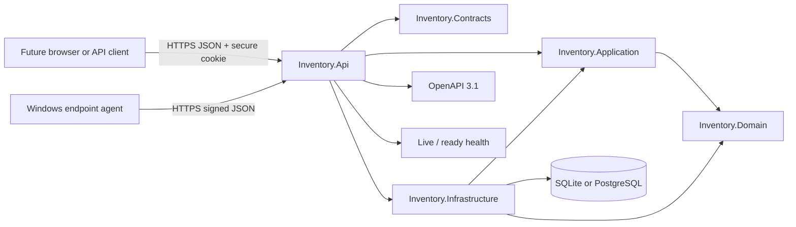

# Architecture overview

## Decision

The rewrite is one controller-based ASP.NET Core 10 service and one relational
database. Internal project boundaries keep HTTP contracts, use cases, domain rules,
and infrastructure concerns separate without the operational cost of microservices.



## Request flow

1. HTTPS, rate limiting, authentication, live-user validation, and authorization run
   before a controller action.
2. Unsafe browser requests validate the antiforgery cookie/header pair. The two
   anonymous machine-ingress actions instead validate a deployment profile/device
   signature, freshness, nonce and rate limit.
3. Controllers map versioned Contracts to Application commands.
4. Application services enforce use-case rules and coordinate Domain entities.
5. Infrastructure implements persistence and Identity ports.
6. Aggregate changes and their history/audit evidence save through one scoped
   DbContext unit of work.
7. Exceptions become non-sensitive Problem Details with a trace identifier.

## Project dependencies

```text
Domain
  ^
  |
Application        Contracts
  ^                    ^
  |                    |
Infrastructure --------+---- Api (composition only)
             Application ---^

Contracts <--- Agent (Windows service)
```

`Api` references Infrastructure to compose the application, but controllers may not
take an Infrastructure data dependency. Architecture tests inspect this rule.

## Transactions and concurrency

- Normal asset commands and their history events are one `SaveChanges` transaction.
- Assignment transfers close prior custody, open new custody, update the asset, and
  append history in that same transaction.
- QR rotation revokes the old identifier before inserting its replacement and event
  inside one explicit database transaction.
- Login/session issuance and every multi-write user/role/password/MFA mutation persist
  their audit row in the same explicit transaction.
- A legacy reconciliation dry run wraps its import validation job, deterministic
  report, and audits in one transaction.
- Managed tag allocation advances its singleton sequence in the same transaction as
  asset creation. A failed create does not consume the tag.
- Bulk commit revalidates the persisted preview and saves every asset, event, job, and
  audit row atomically; one conflict rejects the entire selection.
- Stocktake start persists the session, immutable expected snapshot, and audit
  together. Observations affect only stocktake evidence, never the asset aggregate.
- Attachment upload persists validated bytes, SHA-256 metadata, asset history, and
  audit evidence together in the selected relational database.
- Enrollment consumes the profile allowance, creates the managed device and appends
  its audit row in one explicit transaction. A check-in advances the sequence,
  appends its immutable snapshot, performs any exact asset link and appends audit in
  one transaction.
- Every mutable aggregate has an application-managed Guid version marked as an EF
  concurrency token.
- The API checks the caller's version before changing state; EF also detects races
  between load and commit.

## Security posture

- Cookie authentication is selected for the future same-origin browser client.
- Every business operation is authenticated and names a permission policy; an
  architecture test rejects endpoints with no explicit authorize/anonymous decision.
- Roles only provide understandable claim presets.
- CSRF validation covers login and all other unsafe API methods.
- Anonymous agent ingress is limited to the two signed, bounded and rate-limited
  machine endpoints; it never accepts a cookie as device identity.
- Security stamps are checked every request; an additional live user lookup rejects
  disabled accounts immediately.
- OpenAPI JSON is exposed only in Development.
- Production startup requires protected persistent data-protection keys and separate
  writable database/backup storage outside temporary/deployment/network paths.
- Database migrations are a separate deployment action.
- SQLite runs with foreign keys, a 30-second busy timeout, and persistent WAL mode.
- Production is a single write-capable API instance; PostgreSQL is the documented
  scale-out path if that constraint stops fitting.

## Current module boundary

The host contains cohesive Foundation, Assets, People/Assignments, QR/Warranty,
Import/Export, Identity/School administration, Operations/Recovery, Legacy
Reconciliation, and Operational Workflows modules. The last group contains
dashboard/exception reads, stocktakes, tag policy, bulk changes, bundles, leavers,
attachments, and saved searches while reusing the existing asset and custody
aggregates. They remain internal modules of the monolith. The separate
`Inventory.Agent` process references only versioned Contracts and is deployed as a
least-privileged Windows service; its WiX MSI is a packaging project, not another
backend service.
