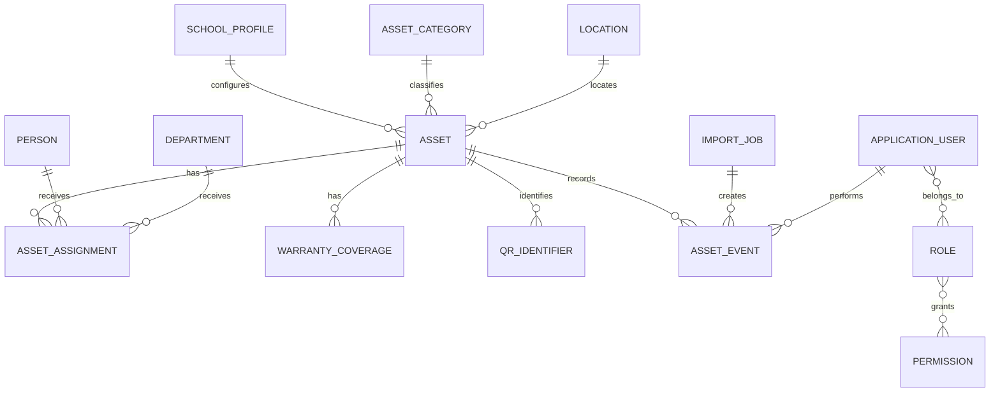
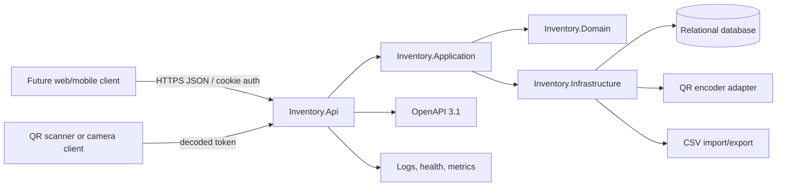
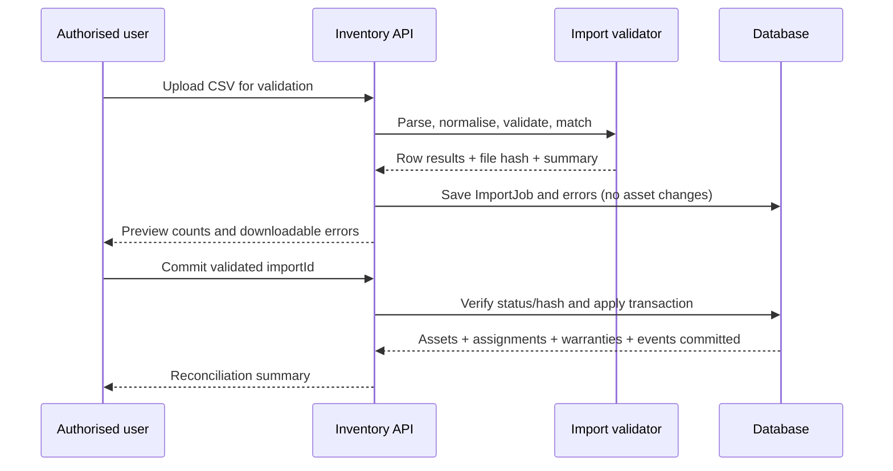

# Inventory System Rewrite Brief Pack
## Single-school backend and API - C# / ASP.NET Core 10

**Status:** Draft 0.1
**Date:** 24 July 2026
**Audience:** Product owner, developers, testers, maintainers, and coding assistants
**Frontend:** Visual design and implementation are explicitly out of scope

---

# Executive summary and decisions

> **Executive decision**
> Rewrite the current trust/school inventory system as a single-school, backend-first application. Build one deployable modular monolith with a documented REST API. Do not retain multi-school tenancy in the new domain model, and do not design or implement the frontend in this phase.

## Document purpose

This pack turns the initial requirements into a buildable product and technical brief. It is intended to be readable by the school, developers, testers, future maintainers, and coding assistants. It defines the MVP boundary, recommended architecture, domain rules, API surface, permission model, migration approach, documentation standard, and acceptance criteria.

## Requested outcomes

- Track equipment and its current state, location, condition, purchase details, and identifiers.
- Answer who currently holds or is responsible for each device, while preserving prior assignments.
- Generate a QR code for an asset and resolve a scanned QR token back to the correct asset.
- Import and export asset data safely and with clear validation results.
- Track warranties and expose active, expiring, and expired coverage.
- Maintain a readable, append-only history of material events for every asset.
- Require login and enforce explicit permissions for every protected action.
- Provide complete API, architecture, deployment, operations, testing, and LLM hand-off documentation.

## Technology baseline

Target net10.0, C# 14, ASP.NET Core 10, and EF Core 10. .NET 10 is an LTS release supported until November 2028 [R1]. EF Core 10 is also an LTS release supported until 10 November 2028 [R2]. ASP.NET Core 10 includes first-party OpenAPI generation and can produce OpenAPI 3.1 documents [R3][R4].

## Working assumptions

| Area | Default used in this brief | Can change before implementation |
| --- | --- | --- |
| Organisation scope | Exactly one school profile; no TenantId or SchoolId on normal domain rows | Only by reopening the product scope |
| Architecture | Modular monolith with a controller-based REST API | Yes, but microservices are not justified for this scope |
| Database | SQLite through EF Core 10 for production and tests | PostgreSQL is a deliberate future migration if SQLite no longer fits |
| Authentication | ASP.NET Core Identity with secure cookie authentication for the future browser client | Yes - Microsoft Entra ID can replace or supplement it later |
| People | People assigned assets are separate from login users | No - this separation prevents every pupil/staff record needing an account |
| Import/export | UTF-8 CSV is mandatory for MVP; XLSX is optional later | Yes |
| QR scanning | Backend generates and resolves codes; camera/scanner UI belongs to the future frontend | No - browser/mobile camera access is client-side work |
| Deletion | Assets, assignments, warranties, login accounts, and history are archived/retired rather than hard-deleted | Exceptional data purge can be an administrator-only operational process |

---

# 01. Product and Scope Brief

> Defines the problem, users, MVP boundary, success outcomes, and non-goals.

> **Product statement**
> A secure single-school inventory service that lets authorised staff identify an asset, see where it is and who has it, understand its warranty and full lifecycle, and exchange data without losing auditability.

## Problem to solve

The present system carries trust/multi-school scope that is not needed for the immediate use case. The rewrite should remove that complexity rather than hide it. The new system must make the common operational questions easy to answer: What is this item? Where is it? Who has it? Is it covered? What changed, when, and by whom?

## Primary users

| User | Main goals | Typical access |
| --- | --- | --- |
| System Administrator | Configure the service, manage users and roles, investigate audit events | Full administrative access |
| Inventory Manager | Maintain the asset register, assignments, warranties, imports, exports, and data quality | All inventory operations except system security settings |
| Technician | Register, locate, assign, return, scan, and update day-to-day equipment | Operational changes; no user administration or bulk import commit |
| Read-only Auditor | Review assets, assignments, warranties, history, and controlled exports | Read-only access plus explicitly granted export/audit access |
| Asset holder | No direct system use is required | Represented as a Person or Department, not necessarily a login account |

## MVP scope

- Single school profile and school-wide settings.
- Asset register with unique asset tags, categories, manufacturer/model, serial number, condition, status, location, purchase data, supplier, notes, and legacy identifier.
- People, departments, and locations used as assignment and reporting references.
- Current assignment and complete assignment history, including issue, transfer, and return.
- QR identifier generation, download, rotation, and authenticated resolution.
- Warranty coverage records, computed warranty state, filters, and expiring-soon query.
- Append-only asset event history and separate security/administrative audit log.
- CSV import validation, preview, commit, error reporting, and reconciliation.
- CSV export with filters, stable column names, safe escaping, and audit entries.
- Local login, role presets, permission policies, user enable/disable, password reset workflow, and MFA support for privileged accounts.
- Versioned REST API, OpenAPI 3.1 document, examples, developer guide, deployment guide, operations runbook, and automated tests.

## Explicitly out of scope

- Trust-wide or multi-school tenancy, cross-school reporting, or school switching.
- Frontend visual design, page layout, component selection, responsive design, or camera UX.
- Procurement approvals, purchase orders, depreciation, finance ledger integration, or stock valuation.
- Helpdesk tickets, repairs workflow beyond a simple status/history event, MDM/RMM integration, or remote device control.
- Automatic email/SMS notifications, public unauthenticated asset details, or native mobile applications.
- Self-service account registration and direct login access for every pupil or staff assignee.

## Success measures

| Outcome | Evidence of success |
| --- | --- |
| Reliable asset identification | A unique asset tag or QR scan resolves to exactly one active asset record. |
| Clear custody | Every assigned asset shows one current assignment and a complete, dated history of earlier assignments. |
| Safe bulk data handling | Imports cannot commit until validation passes; exports are reproducible, permission-checked, and logged. |
| Actionable warranty data | Users can filter active/expiring/expired coverage and see the source dates and provider. |
| Accountability | Material changes create immutable asset events containing actor, time, source, and a clear summary. |
| Maintainability | A new developer or coding assistant can run, test, navigate, and modify the service using repository documentation alone. |

## Terminology decision

> **Use 'assignment' or 'custody', not legal ownership**
> The school remains the organisational owner of its equipment. The system records which person or department currently holds or is responsible for an asset. This avoids ambiguous reporting such as treating a pupil as the legal owner of a school device.

---

# 02. Functional Requirements Brief

> Defines user-visible behaviour and the rules that make the inventory trustworthy.

## Requirement catalogue

| ID | Priority | Capability | Acceptance statement |
| --- | --- | --- | --- |
| FR-001 | Must | Create and retrieve assets | An authorised user can create an asset with a unique asset tag and retrieve it by ID or asset tag. |
| FR-002 | Must | Search and filter assets | Search supports asset tag, serial, manufacturer, model, person, department, and location; list results are paged. |
| FR-003 | Must | Update lifecycle data | Authorised users can update details, condition, status, location, purchase data, and notes with concurrency protection. |
| FR-004 | Must | Retire, restore, and dispose | Retirement and disposal record separate reason/date metadata, close active assignment, and never hard-delete the asset; disposal is terminal. |
| FR-005 | Must | Assign to a person or department | Exactly one current assignment may exist for an asset; transfers close the previous assignment in the same transaction. |
| FR-006 | Must | Return an asset | Return records time, actor, optional condition/location, and updates the asset status. |
| FR-007 | Must | View holder inventory | A person or department record lists all currently assigned assets and optionally historical assignments. |
| FR-008 | Must | Generate asset QR code | A user with QR permission can retrieve SVG or PNG for the asset's active QR identifier. |
| FR-009 | Must | Resolve scanned QR | An authenticated request using a valid QR token returns the matching asset summary; revoked tokens fail safely. |
| FR-010 | Must | Rotate QR token | A manager can rotate a damaged/compromised label; the old token is revoked and the action is recorded. |
| FR-011 | Must | Track warranty coverage | Users can add/update coverage and query active, expiring, and expired warranties. |
| FR-012 | Must | View asset history | History shows chronological business events including actor, source, summary, and changed values where appropriate. |
| FR-013 | Must | Validate CSV import | Upload performs schema, type, reference, duplicate, and business-rule validation without changing live data. |
| FR-014 | Must | Commit validated import | A validated import can be committed by a permitted user; commit is atomic within the configured row limit and creates history events. |
| FR-015 | Must | Export assets | A permitted user can export filtered asset data with current assignment and warranty fields using stable UTF-8 CSV columns. |
| FR-016 | Must | Authenticate | All business endpoints require an authenticated, enabled user; self-registration is disabled. |
| FR-017 | Must | Authorise by permission | Every write, import/export, audit, and administration endpoint declares and tests a named permission policy. |
| FR-018 | Must | Manage users and role presets | Administrators can seed the first account, create, edit, disable, archive/restore, reset, and assign roles without editing the database directly. |
| FR-019 | Must | Expose API documentation | The running service exposes a versioned OpenAPI document with schemas, summaries, permission notes, examples, and error contracts. |
| FR-020 | Should | Warranty due report | Users can retrieve coverage ending inside a configurable number of days; default working threshold is 60 days. |
| FR-021 | Should | Manual history note | Permitted users can append a dated note without editing or deleting earlier events. |
| FR-022 | Should | Print QR labels | A permitted user can generate a print-ready individual label or bounded batch PDF containing the asset tag, device name, and QR code. |

## Core business rules

| Rule | Required behaviour |
| --- | --- |
| Unique identity | AssetTag is required and case-insensitively unique. SerialNumber is optional; a duplicate serial is an error unless an authorised override rule is explicitly introduced later. |
| Single active assignment | An asset has zero or one open assignment. A transfer closes the current assignment and opens the new one atomically. |
| Assignment target | An assignment points to exactly one Person or Department. Location is tracked separately because the holder and physical location can differ. |
| Status consistency | Assigned assets normally have status Assigned; a return normally moves to InStock. Repair, Lost, Stolen, Retired, and Disposed restrict assignment actions. |
| No silent overwrites | Interactive updates and import commits use a version/concurrency token. Stale writes return a conflict and never replace newer data silently. |
| History integrity | Every material lifecycle change creates an append-only AssetEvent in the same transaction as the change. |
| Time and dates | Event timestamps are stored in UTC. Purchase and warranty dates use date-only values because time-of-day is not meaningful. |
| Money | Purchase cost uses decimal plus ISO currency code. It is optional and protected by the same export permissions as other asset data. |
| QR privacy | The QR payload contains a random token or URL containing that token. It must not contain a person's name, serial number, email, or other readable sensitive data. |
| Retirement | Retiring an asset requires a reason and closes any active assignment. Disposal can be recorded as a status/event but does not erase history. |

## Recommended status model

| Status | Meaning | Assignment allowed |
| --- | --- | --- |
| InStock | Available and controlled by the school | Yes |
| Reserved | Set aside for a known future use | Only through an explicit assign/issue action |
| Assigned | Currently issued to a person or department | Already has one active assignment |
| Repair | Unavailable while being inspected or repaired | No |
| Lost | Not located; investigation may be active | No |
| Stolen | Reported stolen | No |
| Retired | Removed from operational use but retained for history | No |
| Disposed | Physically disposed or transferred out | No; terminal in normal operation |

## Recommended condition model

Use a small controlled list: New, Good, Fair, Damaged, and Unserviceable. Free-text condition notes may be added to an assignment return or history note.

## Warranty state calculation

| State | Calculation |
| --- | --- |
| NotRecorded | No usable coverage dates are stored. |
| Future | Coverage start date is after today. |
| Active | Today falls between start and end and the end is outside the expiring-soon threshold. |
| ExpiringSoon | Coverage is active and ends within the configured threshold, initially 60 days. |
| Expired | Coverage end date is before today. |

---

# 03. Domain and Data Brief

> Defines the core entities, relationships, integrity rules, and history model.

> **Data model principle**
> Model the single school directly. Keep one SchoolProfile for configuration, but do not copy a school/tenant key onto every asset, person, assignment, or history row. Future trust support would be a deliberate product change, not dormant complexity inside the MVP.

## Logical entities

| Entity | Purpose | Key information |
| --- | --- | --- |
| SchoolProfile | One-row configuration | Name, code, timezone, QR base URL, warranty threshold |
| Asset | The equipment record | Id, AssetTag, category, manufacturer, model, serial, status, condition, location, purchase fields, legacy ID, concurrency version |
| AssetCategory | Controlled classification | Name, code, description, active flag |
| Location | Physical hierarchy | Code, name, parent location, type, active flag |
| Department | Shared responsibility target | Code, name, active flag |
| Person | Staff, pupil, contractor, or other holder | External ID, display name, person type, email optional, active flag |
| AssetAssignment | Custody period | Asset, Person or Department, assigned/returned times, issuer/returner, notes, condition/location at handover |
| WarrantyCoverage | One coverage period | Provider, type, start/end dates, reference, notes, primary flag |
| QrIdentifier | Stable scannable identifier | Random token hash/value, version, issued/revoked times, issuer |
| AssetEvent | User-readable immutable lifecycle event | Type, asset, occurred UTC, actor, source, summary, structured JSON details, correlation/import ID |
| ImportJob | Validation and commit record | File name/hash, mode, status, counts, actor, created/committed times, error report |
| ApplicationUser | Login identity | Identity fields, enabled flag, linked Person optional |
| Role / Permission | Authorisation presets and policies | Role name, permission keys, assignments |
| AuditLog | Security/administrative audit | Actor, action, target, UTC time, outcome, IP/client metadata, correlation ID |

## Relationship source

Store the following Mermaid source in the repository so both humans and LLMs can render or inspect the domain model:



## Important data constraints

- Use server-generated GUID identifiers for API resources; never expose database sequence assumptions.
- Create a case-insensitive unique index on Asset.AssetTag.
- Create unique indexes for active Location.Code and Department.Code; Person.ExternalId is unique when present.
- Enforce exactly one assignment target: PersonId XOR DepartmentId.
- Enforce zero or one active assignment per asset using database support where practical and a transaction-safe application rule in all providers.
- Warranty end date cannot precede start date.
- QR tokens are globally unique, random, revocable, and never reused for a different asset.
- AssetEvent rows are not updated or deleted through normal application endpoints.
- Use an application-managed concurrency token or provider-native row version on mutable aggregate records [R8].

## Asset history versus audit log

| Concern | AssetEvent | AuditLog |
| --- | --- | --- |
| Audience | Inventory users | Administrators and auditors |
| Purpose | Explain the asset lifecycle in plain language | Record security-sensitive and administrative activity |
| Examples | Assigned, returned, moved, warranty changed, retired | Login failed, user disabled, role changed, export generated |
| Target | Always linked to one asset | Can target users, roles, settings, imports, exports, or assets |
| Mutability | Append-only | Append-only with retention controlled by policy |

## History event catalogue

At minimum implement: AssetCreated, AssetDetailsChanged, StatusChanged, ConditionChanged, LocationChanged, Assigned, Transferred, Returned, WarrantyAdded, WarrantyChanged, WarrantyArchived, QrIssued, QrRotated, ImportCreated, ImportUpdated, Retired, Restored, and NoteAdded. Each event contains a concise summary and structured details suitable for future UI display without re-querying old database states.

## Delete and retention policy

Normal users archive people/reference data and retire assets. Assignments, warranties, events, and audit records are retained. A separate administrator-only purge process may be added for legal retention or erroneous test data, but it must create an audit record and must not be exposed as ordinary CRUD.

---

# 04. API Contract Brief

> Defines API style, endpoint groups, conventions, errors, versioning, and documentation requirements.

> **API decision**
> Use a controller-based REST API under /api/v1. Keep the HTTP layer explicit and predictable. Do not introduce GraphQL, event-driven microservices, or a generic CRUD framework for the MVP.

## API conventions

- JSON request/response bodies use camelCase and System.Text.Json.
- Resource identifiers are GUID strings. AssetTag remains the human-facing identifier.
- Collection endpoints are paged and return items, page, pageSize, and totalCount.
- Filters use query parameters; sort fields are allow-listed to prevent unsafe dynamic queries.
- All timestamps are ISO 8601 UTC. Date-only values use YYYY-MM-DD.
- Create returns 201 with Location. Successful command endpoints return 200/204 as documented.
- Validation and server errors use Problem Details. ASP.NET Core has built-in ProblemDetails support for API error responses [R9].
- Stale version tokens return 409 Conflict. Duplicate tags/references also return a specific 409 problem type.
- Every endpoint has an operation ID, summary, description, response schemas, examples, and required permission in OpenAPI.
- The generated OpenAPI document is treated as a release artifact and checked for unintended changes in CI.

## Proposed endpoint catalogue

| Group | Method and route | Purpose | Permission |
| --- | --- | --- | --- |
| Auth | POST /api/v1/auth/login | Create an authenticated browser session | Anonymous |
| Auth | POST /api/v1/auth/logout | End the current session | Authenticated |
| Auth | GET /api/v1/auth/me | Return current user, roles, and permissions | Authenticated |
| Auth | POST /api/v1/auth/change-password | Change own password | Authenticated |
| Assets | GET /api/v1/assets | Paged search and filtering | assets.read |
| Assets | POST /api/v1/assets | Create an asset | assets.create |
| Assets | GET /api/v1/assets/{assetId} | Get full asset details | assets.read |
| Assets | PUT /api/v1/assets/{assetId} | Update asset using version token | assets.update |
| Assets | POST /api/v1/assets/{assetId}/retire | Retire with reason | assets.retire |
| Assets | POST /api/v1/assets/{assetId}/restore | Restore a retired asset | assets.restore |
| Assets | POST /api/v1/assets/{assetId}/dispose | Permanently mark an asset disposed with reason | assets.retire |
| History | GET /api/v1/assets/{assetId}/history | Paged asset history | history.read |
| History | POST /api/v1/assets/{assetId}/history/notes | Append a manual note | history.note |
| Assignments | GET /api/v1/assets/{assetId}/assignments | Current and prior assignments | assignments.read |
| Assignments | POST /api/v1/assets/{assetId}/assignments | Assign or transfer | assignments.manage |
| Assignments | POST /api/v1/assets/{assetId}/assignments/{assignmentId}/return | Return an issued asset | assignments.manage |
| People | GET /api/v1/people | Search people | people.read |
| People | POST /api/v1/people | Create a person | people.manage |
| People | GET /api/v1/people/{personId}/assets | List a person's current assets | assets.read |
| Locations | GET /api/v1/locations | List/search locations | assets.read |
| Locations | GET /api/v1/locations/{locationId} | Get a location | assets.read |
| Locations | POST /api/v1/locations | Create location | reference.manage |
| Locations | PUT /api/v1/locations/{locationId} | Edit/archive/restore location | reference.manage |
| Reference | GET /api/v1/categories | List asset categories | assets.read |
| Reference | GET /api/v1/categories/{categoryId} | Get an asset category | assets.read |
| Reference | POST /api/v1/categories | Create category | reference.manage |
| Reference | PUT /api/v1/categories/{categoryId} | Edit/archive/restore category | reference.manage |
| Warranty | GET /api/v1/assets/{assetId}/warranties | List coverages | warranties.read |
| Warranty | POST /api/v1/assets/{assetId}/warranties | Add coverage | warranties.manage |
| Warranty | PUT /api/v1/warranties/{warrantyId} | Update coverage | warranties.manage |
| Warranty | GET /api/v1/warranties/expiring | Query upcoming expiries | warranties.read |
| QR | GET /api/v1/assets/{assetId}/qr | Return SVG/PNG for active token | qr.generate |
| QR | POST /api/v1/assets/{assetId}/qr/rotate | Revoke and replace QR token | qr.rotate |
| QR labels | POST /api/v1/assets/{assetId}/label | Return one or more print-ready labels for one asset | qr.print |
| QR labels | GET /api/v1/labels/stocks | List supported physical label stock | qr.print |
| QR labels | POST /api/v1/labels/batch | Return a bounded multi-asset label PDF | qr.print |
| QR | GET /api/v1/qr/{token} | Resolve token to asset summary | assets.read |
| Imports | POST /api/v1/imports/assets/validate | Upload and validate CSV | imports.validate |
| Imports | GET /api/v1/imports/{importId} | Read validation/commit result | imports.read |
| Imports | POST /api/v1/imports/{importId}/commit | Commit a valid import | imports.commit |
| Imports | GET /api/v1/imports/{importId}/errors.csv | Download row errors | imports.read |
| Exports | GET /api/v1/exports/assets.csv | Stream filtered asset export | exports.assets |
| Users | GET /api/v1/users | List users | users.manage |
| Users | GET /api/v1/users/{userId} | Retrieve a user | users.manage |
| Users | GET /api/v1/users/role-presets | List assignable presets and permissions | users.manage |
| Users | POST /api/v1/users | Create a user; no public registration | users.manage |
| Users | PUT /api/v1/users/{userId} | Edit profile, enabled state, and roles with concurrency | users.manage |
| Users | PUT /api/v1/users/{userId}/roles | Set role assignments | users.manage |
| Users | POST /api/v1/users/{userId}/disable | Disable login | users.manage |
| Users | DELETE /api/v1/users/{userId} | Archive account and disable login | users.manage |
| Users | POST /api/v1/users/{userId}/restore | Restore an archived account | users.manage |
| Users | POST /api/v1/users/{userId}/reset-password | Set a temporary password atomically | users.manage |
| System | GET /health/live | Liveness probe | Deployment policy |
| System | GET /health/ready | Readiness including database | Deployment policy |
| System | GET /openapi/v1.json | OpenAPI 3.1 contract | Environment policy |

## Representative asset response

```json
{
  "id": "f4dd9d0d-787e-4a52-9670-52b3bf17d079",
  "assetTag": "SCH-000123",
  "category": { "id": "...", "name": "Laptop" },
  "manufacturer": "Dell",
  "model": "Latitude 5450",
  "serialNumber": "ABC12345",
  "status": "assigned",
  "condition": "good",
  "location": { "id": "...", "code": "B1-204", "name": "Room 204" },
  "currentAssignment": {
    "assignmentId": "...",
    "targetType": "person",
    "person": { "id": "...", "displayName": "A. Patel", "externalId": "STF-1042" },
    "assignedAtUtc": "2026-07-20T09:12:44Z"
  },
  "warrantySummary": {
    "state": "active",
    "endsOn": "2028-08-31",
    "daysRemaining": 769
  },
  "qrCodeUrl": "/api/v1/assets/f4dd9d0d-787e-4a52-9670-52b3bf17d079/qr",
  "version": "a891d01c-8f11-4e5d-85c6-9b6f02ef137b"
}
```

## Representative conflict response

```json
{
  "type": "https://inventory.example/problems/concurrency-conflict",
  "title": "The asset was changed by another user.",
  "status": 409,
  "detail": "Reload the asset and retry using the latest version token.",
  "instance": "/api/v1/assets/f4dd9d0d-787e-4a52-9670-52b3bf17d079",
  "traceId": "00-..."
}
```

## Asset list filters

GET /api/v1/assets should support q, assetTag, serialNumber, categoryId, status, condition, locationId, departmentId, assignedPersonId, assigned, warrantyState, warrantyEndsBefore, createdFrom, createdTo, legacyId, page, pageSize, and sort. The API must cap pageSize and document default sorting.

## OpenAPI and interactive documentation

Use Microsoft.AspNetCore.OpenApi for first-party document generation [R4]. ASP.NET Core 10 can generate OpenAPI 3.1 [R3]. An interactive explorer such as Scalar may be enabled in development or a protected internal environment, while the JSON contract remains the source of truth [R5].

## Compatibility rules

- Breaking request/response changes require a new API version or an explicitly approved migration plan.
- Adding optional response fields is non-breaking; removing or renaming fields is breaking.
- Enum values are lower camel-case strings and require careful compatibility review before additions.
- Do not return EF Core entities directly. Use dedicated request and response contracts.
- Do not expose internal permission storage, password fields, QR secret generation details, or raw audit metadata in general asset responses.

---

# 05. Technical Architecture Brief

> Defines the recommended solution structure, runtime choices, integration boundaries, and operational posture.

> **Architecture choice**
> Build a modular monolith: one deployable ASP.NET Core service and one relational database, with internal project boundaries that keep domain rules, use cases, HTTP contracts, and infrastructure separate. This is easier to operate and test than microservices and fully meets the single-school scope.

## Target stack

| Layer | Choice | Notes |
| --- | --- | --- |
| Language/runtime | C# 14 on .NET 10 LTS | Target net10.0; do not enable preview language features [R1][R10]. |
| Web framework | ASP.NET Core 10 controllers | Versioned JSON REST API; no frontend project in this phase. |
| Persistence | EF Core 10 | Migrations, explicit configurations, optimistic concurrency, integration tests against the production provider [R2][R8]. |
| Database | SQLite production/test provider | Use one local durable database; PostgreSQL requires a deliberate migration project. |
| Identity | ASP.NET Core Identity | Admin-created users, secure cookies for the later browser UI, policy-based permissions [R6][R7]. |
| API description | Microsoft.AspNetCore.OpenApi | OpenAPI 3.1, generated from runtime endpoints [R3][R4]. |
| Serialization | System.Text.Json | Shared JSON options and explicit contracts. |
| Logging | Microsoft.Extensions.Logging abstraction | Structured events and correlation IDs; provider selected by deployment. |
| QR | IAssetQrService adapter | Choose a maintained, permissively licensed encoder package at implementation time; no QR library types leak into application/domain projects. |
| CSV | Streaming parser/writer adapter | Strict headers, configurable size/row limits, safe spreadsheet export. |

## Suggested repository structure

```text
Inventory.sln
src/
  Inventory.Api/             # Controllers, auth, middleware, OpenAPI, composition root
  Inventory.Application/     # Use cases, validation, permission-independent orchestration
  Inventory.Domain/          # Entities, value objects, rules, event definitions
  Inventory.Infrastructure/  # EF Core, Identity, QR adapter, CSV, clock, persistence
  Inventory.Contracts/       # Versioned HTTP request/response contracts

tests/
  Inventory.Domain.Tests/
  Inventory.Application.Tests/
  Inventory.Api.IntegrationTests/
  Inventory.Architecture.Tests/

docs/
  index.md
  product-scope.md
  domain-model.md
  api-conventions.md
  permissions.md
  qr-codes.md
  import-export.md
  deployment.md
  operations-runbook.md
  testing.md
  adr/

AGENTS.md
README.md
Directory.Build.props
```

## Container diagram source



## Dependency rules

- Domain references no ASP.NET Core, EF Core, Identity, file format, or QR package.
- Application references Domain and exposes use-case interfaces and results.
- Infrastructure implements persistence, Identity, QR, CSV, and time/IO interfaces.
- API references Application, Infrastructure, and Contracts only to compose and expose the service.
- Contracts contain no EF entities and are versioned with the API.
- Cross-cutting behaviour such as validation, authorisation, transactions, logging, and history creation is explicit and testable; avoid hidden reflection-heavy pipelines unless they clearly reduce complexity.

## Transaction boundaries

Commands that change an asset and its history run in one database transaction. Assignment transfer closes the old assignment, opens the new assignment, updates asset state, and appends history atomically. Import commit applies validated changes and events atomically within the configured MVP row limit.

## Concurrency

Expose a version token on mutable resources and require it for updates. EF Core optimistic concurrency detects a stale write and the API returns a 409 response instead of overwriting another user's change [R8].

## Configuration and secrets

- Use typed options with startup validation.
- Store connection strings, signing/data-protection material, and credentials in environment-specific secret storage, never source control.
- Configuration includes school name/code, timezone, public QR base URL, warranty warning days, import limits, allowed origins, and cookie settings.
- Fail startup when required production settings are absent or unsafe.

## Observability and operations

- Structured request and domain-operation logs with correlation/trace IDs.
- Separate /health/live and /health/ready endpoints. ASP.NET Core provides health check middleware for application and dependency probes [R11].
- Log import/export job IDs, counts, duration, outcome, and actor without logging raw passwords or full sensitive file content.
- Metrics for request failures, latency, authentication failures, import errors, QR resolution failures, and database health.
- Rate-limit login, password reset, and any externally exposed QR resolver. ASP.NET Core includes rate-limiting middleware [R12].

## Deployment posture

The service should run either as a container or a standard ASP.NET Core process behind HTTPS. Database migrations are applied by an explicit deployment step, not opportunistically by every production instance. Releases include the application, migration instructions, OpenAPI contract, configuration reference, and rollback notes.

---

# 06. Security and Permissions Brief

> Defines login, role presets, permission policies, privileged operations, and privacy controls.

> **Security model**
> Use roles as understandable presets, but enforce named permissions through ASP.NET Core policies. The application should default-deny: authenticated users receive no business access unless their role grants the endpoint's permission.

## Authentication

- Use ASP.NET Core Identity for local accounts and credential lifecycle. Identity manages users, passwords, roles, claims, tokens, and related account features [R6].
- Disable public registration. Administrators create or invite users.
- Use secure, HTTP-only, same-site cookies for the later browser-based frontend. Microsoft's API guidance recommends cookies for browser applications because tokens are not exposed to JavaScript [R7].
- Protect state-changing cookie-authenticated requests against cross-site request forgery.
- Enable account lockout, secure password reset, security-stamp invalidation, and configurable password policy.
- Support MFA and require it for System Administrator accounts in production; consider the same for Inventory Managers.
- A later Entra ID/SSO integration should map external identities to the same application roles and permissions rather than rewriting business authorisation.

## Role preset matrix

| Permission | Administrator | Inventory Manager | Technician | Read-only Auditor |
| --- | --- | --- | --- | --- |
| assets.read | Yes | Yes | Yes | Yes |
| assets.create | Yes | Yes | Yes | No |
| assets.update | Yes | Yes | Yes | No |
| assets.retire / restore | Yes | Yes | No | No |
| assignments.read | Yes | Yes | Yes | Yes |
| assignments.manage | Yes | Yes | Yes | No |
| people.read | Yes | Yes | Yes | Yes |
| people.manage | Yes | Yes | Limited | No |
| warranties.read | Yes | Yes | Yes | Yes |
| warranties.manage | Yes | Yes | Yes | No |
| history.read | Yes | Yes | Yes | Yes |
| history.note | Yes | Yes | Yes | No |
| qr.generate | Yes | Yes | Yes | No |
| qr.print | Yes | Yes | Yes | No |
| qr.rotate | Yes | Yes | No | No |
| imports.validate | Yes | Yes | No | No |
| imports.commit | Yes | Yes | No | No |
| exports.assets | Yes | Yes | No | Yes |
| reference.manage | Yes | Yes | No | No |
| audit.read | Yes | No | No | Yes |
| users.manage | Yes | No | No | No |
| settings.manage | Yes | No | No | No |

## Authorisation implementation

Define each permission as a named ASP.NET Core policy. Policies are evaluated through requirements/handlers and can later support resource-specific checks [R13]. Controllers/actions declare the policy explicitly. Do not rely on hiding UI buttons as security. Add automated tests that prove allowed roles succeed and disallowed roles receive 403.

## High-risk actions

| Action | Additional control |
| --- | --- |
| User/role changes | Administrator only; create AuditLog entry with before/after role set. |
| Import commit | Manager/admin only; require prior successful validation and matching file hash. |
| Asset export | Explicit permission; log filters, row count, actor, and completion. |
| QR rotation | Manager/admin only; revoke old token, issue new token, and append asset history. |
| Asset retirement/restore/disposal | Manager/admin; reason required for retire/dispose; history event and assignment closure; disposal is terminal. |
| Operational purge | Not part of normal API; documented break-glass process with approval and audit. |

## Privacy and data minimisation

- Store only the person fields needed to identify an assignee: external ID, display name, type, optional email, and active state.
- Do not encode personal data in QR payloads or filenames.
- Do not include personal data in general logs. Use IDs and controlled summaries.
- Limit exports to requested fields and permission scope; document who can see person identifiers and purchase costs.
- Separate public health probes from protected readiness details; do not expose connection strings, exception traces, or database metadata.
- Apply file size, row count, content type, and processing limits to imports. CSV input avoids macro execution, but formula-like values still require careful export escaping.

## Security acceptance tests

- Unauthenticated requests to business endpoints return 401.
- Authenticated users without the policy receive 403.
- Disabled users cannot create new sessions and existing sessions are invalidated promptly.
- A QR token never reveals asset data without authentication.
- Stale or revoked QR tokens return a non-sensitive not-found/gone response.
- Exports and import commits create audit entries.
- No API response contains password hashes, security stamps, secrets, or raw exception details.

---

# 07. QR, Import/Export, and Migration Brief

> Defines the scannable identifier contract, safe bulk data flows, and migration from the existing system.

## QR code contract

> **Important boundary**
> The backend can create QR images and resolve decoded tokens. Camera access and scanning interaction belong to the future frontend or a hardware scanner client and are not frontend design work for this phase.

- Each asset has one active QrIdentifier and may have prior revoked identifiers.
- Generate at least 128 bits of randomness. Do not derive the token from AssetTag, database ID, serial number, or person details.
- Preferred payload is a configurable HTTPS URL such as https://inventory.school.example/scan/{token}. The future client can authenticate and resolve it.
- GET /api/v1/assets/{assetId}/qr returns SVG by default and PNG when requested. The image is generated on demand; no binary storage is required for MVP.
- GET /api/v1/qr/{token} requires assets.read and returns a limited asset summary or a redirect contract agreed with the frontend later.
- Rotation revokes the old token immediately, increments QR version, and creates an asset event.
- Print-ready PDF output supports 62 x 29 mm roll labels and Avery L7159-compatible
  63.5 x 33.9 mm, 24-up A4 sheets. Partial first sheets use a one-based start
  position; output must be printed at actual size.

## Asset import workflow



## CSV import columns

| Column | Requirement | Rule |
| --- | --- | --- |
| assetTag | Required | Unique human-facing school asset tag |
| category | Required | Existing category name/code or create-reference rule if enabled |
| manufacturer | Optional | Free text |
| model | Optional | Free text |
| serialNumber | Optional | Duplicate is an error by default |
| status | Optional | Defaults to InStock |
| condition | Optional | Defaults to Good or configured value |
| locationCode | Optional | Must resolve to an active location |
| departmentCode | Optional | Assignment target when no person is supplied |
| assignedPersonExternalId | Optional | Assignment target when supplied |
| purchaseDate | Optional | YYYY-MM-DD |
| purchaseCost | Optional | Invariant decimal |
| currency | Optional | ISO code, default configured |
| supplier | Optional | Free text |
| warrantyStartDate | Optional | YYYY-MM-DD |
| warrantyEndDate | Optional | YYYY-MM-DD; not before start |
| warrantyProvider | Optional | Free text |
| warrantyReference | Optional | Free text |
| legacyId | Optional | Stable source-system identifier used for reconciliation |
| notes | Optional | Plain text; size-limited |

## Import validation rules

- Require UTF-8 and a documented header row. Reject unknown mandatory schema versions rather than guessing.
- Normalise whitespace and case for matching without changing display text unexpectedly.
- Detect duplicate asset tags and serial numbers inside the file and against live data.
- Resolve category, location, department, and person references; return row/column errors for unresolved values.
- Validate status/condition enum values, dates, decimal/currency values, warranty ranges, notes length, and assignment conflicts.
- Support explicit modes: CreateOnly and UpsertByAssetTag. UpsertByLegacyId may be enabled for migration. Never silently choose a match mode.
- Store original file name, SHA-256 hash, uploader, validation time, row counts, and result. Commit must verify the same stored validation result and hash.
- MVP commit is all-or-nothing up to a configured row limit. Larger files are rejected or handled by a future controlled batching design.
- A successful commit creates asset events that identify the import job and changed fields.

## Export rules

- Export UTF-8 CSV with a stable schema version and documented column order.
- Allow the same major filters as the asset list and include current assignment, location, status, condition, warranty summary, purchase data, and legacy ID when permitted.
- Escape commas, quotes, and newlines correctly. Neutralise cells that could execute as spreadsheet formulas when opened in common spreadsheet software.
- Record actor, timestamp, filter summary, output row count, and outcome in AuditLog.
- Do not expose password/account data or internal QR token values in asset exports.

## Rewrite migration approach

- Inventory the current schema and identify the one school whose data will move.
- Export a read-only source snapshot and preserve a backup before transformation.
- Map legacy school/trust data into the single SchoolProfile; do not import unused schools or retain dormant tenancy columns.
- Preserve source identifiers in Asset.LegacyId and equivalent migration metadata for people/reference data where useful.
- Migrate active and retired assets, current assignments, warranty dates, and as much historical event data as the source can support without inventing detail.
- Treat login users separately from assigned people. Do not migrate password hashes unless compatibility and security have been explicitly proven; prefer account recreation/reset.
- Run the same validation pipeline used for normal imports, then produce source-versus-target counts, duplicate reports, unmapped references, and sampled record comparisons.
- Perform a final cutover export after write freeze, rerun reconciliation, and retain a documented rollback path to the source snapshot.

## Migration reconciliation

| Check | Required evidence |
| --- | --- |
| Asset count | Source selected-school assets = imported + deliberately excluded, with reasons. |
| Current assignments | Every source active assignment maps to one target assignment or a documented exception. |
| Identifiers | No duplicate active AssetTag; legacy IDs preserved and unique within source type. |
| Warranty | Date ranges parse correctly; invalid/missing values reported rather than silently repaired. |
| History | Event counts and time ranges reported; known source gaps recorded. |
| Users | Authorised users recreated/mapped; disabled/obsolete accounts not silently activated. |

---

# 08. Documentation, Testing, and Quality Brief

> Defines what must be documented and verified so the service is maintainable by humans and coding assistants.

> **Documentation definition of done**
> A feature is not complete when only the code works. Its domain rule, endpoint contract, permission, examples, tests, configuration, migration impact, and operational behaviour must also be documented in the repository.

## Required documentation set

```text
README.md                         # Purpose, prerequisites, run/test commands, configuration
AGENTS.md                         # Repo map and non-negotiable rules for coding assistants
CHANGELOG.md                      # Release-visible changes

docs/index.md                    # Documentation map and ownership

docs/product/
  scope.md                       # MVP, non-goals, users, glossary
  acceptance-criteria.md

docs/architecture/
  overview.md                    # Context/container diagrams and dependency rules
  data-model.md                  # Mermaid ERD and invariants
  adr/0001-modular-monolith.md
  adr/0002-single-school.md
  adr/0003-authentication.md

docs/api/
  conventions.md                 # Versioning, errors, pagination, concurrency
  examples.md                    # Copyable requests/responses
  permissions.md                 # Endpoint-to-policy map
  openapi-v1.json                # Generated release contract

docs/features/
  assets.md
  assignments.md
  warranties.md
  qr-codes.md
  import-export.md
  history-and-audit.md

docs/operations/
  deployment.md
  configuration.md
  database-migrations.md
  backup-and-restore.md
  monitoring.md
  incident-runbook.md

docs/development/
  testing.md
  coding-conventions.md
  adding-an-endpoint.md
  adding-a-permission.md
  sample-data.md
```

## LLM-readable repository guidance

AGENTS.md should be concise and authoritative. It must state the project purpose, commands, solution map, dependency rules, domain invariants, API conventions, permission workflow, migration rules, test expectations, and files that are generated rather than hand-edited. Do not make an LLM infer critical rules from scattered code comments.

## API documentation requirements

- OpenAPI 3.1 generated from the running application, with stable operation IDs and schema names.
- Endpoint summary, detailed description, permission key, request examples, success examples, and each expected ProblemDetails response.
- Copyable examples for create asset, update with version, assign, return, QR resolve, import validate/commit, and export.
- A checked-in release copy or CI artifact of openapi-v1.json, plus a drift check against the application.
- A human API conventions page explaining pagination, filtering, dates, enums, concurrency, authentication, and error handling.

## Test strategy

| Test level | What it proves | Required examples |
| --- | --- | --- |
| Domain unit | Business rules without infrastructure | Status transitions, assignment target, warranty state, retirement rules |
| Application unit | Use-case orchestration and validation | Assign/transfer/return, QR rotate, import matching decisions |
| API integration | Routing, auth, policies, EF persistence, JSON contracts | Every endpoint happy path plus 400/401/403/404/409 cases |
| Database integration | Real provider constraints and migrations | Unique tags, active assignment constraint, concurrency, transaction rollback |
| Contract | OpenAPI and examples remain valid | Schema validation, stable operation IDs, breaking-change detection |
| Migration | Source data is reconciled | Counts, mappings, duplicate handling, sampled assets/assignments/warranties |
| Security | Default-deny and data protection | Role matrix, disabled user, CSRF/cookie settings, export audit, no secret leakage |
| Performance | Common queries remain usable | Asset search/page, person assets, history page, expiring warranty query |

## Engineering quality gates

- Build net10.0 with nullable reference types enabled and warnings treated as errors for solution-owned code.
- Use deterministic formatting and analyzers; CI runs restore, build, tests, migration validation, and OpenAPI validation.
- No controller contains business rules that cannot be tested outside HTTP.
- No direct database access from controllers.
- No public endpoint without an explicit anonymous or permission decision.
- No schema migration without rollback/forward notes and an integration test on a clean database.
- No generated file edited by hand without documenting the generation source.
- Dependencies are pinned, reviewed for licence/maintenance/security, and kept behind abstractions when they represent infrastructure choices.

## Operational documentation

- How to configure and start the service in development and production.
- How to create the first administrator securely.
- How to apply, verify, and roll back database migrations.
- How to back up and restore the database and data-protection keys.
- How to inspect health, logs, import failures, failed login spikes, and QR resolution failures.
- How to rotate secrets, disable a user, revoke QR identifiers, and export audit data.
- How to recover from a failed import or failed deployment.

---

# 09. Delivery Plan, Acceptance, and Decisions Brief

> Provides an implementation sequence, definition of done, acceptance criteria, and the decisions still needing owner approval.

## Recommended delivery sequence

| Milestone | Deliverables | Exit condition |
| --- | --- | --- |
| 0. Foundation and contracts | Solution skeleton, coding rules, database choice, Identity baseline, permission keys, OpenAPI conventions, initial ADRs | Service builds, authenticates, migrates an empty DB, and publishes a minimal contract |
| 1. Asset register | Categories, locations, assets, search/filter, update, concurrency, retire/restore, history base | Asset CRUD/lifecycle and permissions pass integration tests |
| 2. People and assignments | People, departments, assign/transfer/return, holder asset lists, assignment events | Single active assignment and transaction rules proven against production DB provider |
| 3. QR and warranty | QR issue/resolve/rotate, individual and batch label PDFs, warranty coverage and state queries | QR privacy/rotation/printing and warranty calculations pass tests |
| 4. Import/export | CSV schema, validation, preview, commit, error file, filtered export, audit entries | Round-trip and failure/rollback tests pass |
| 4.1. Lifecycle and contract closure | Terminal disposal, reference-data edit/archive/restore, explicit import mode, late-transaction rollback audit, complete OpenAPI examples/errors, drift enforcement, first rewrite commit and CI | Lifecycle bypasses are closed, real late rollback is proven, generated contract is deterministic, and CI is green |
| 5. Migration and hardening | MFA enrollment/enforcement, audit access/export, school settings, trusted proxy/storage validation, role-session invalidation, backup/restore rehearsal, production observability, and legacy mapping/reconciliation | Security/operations exercises and reconciliation evidence are signed off and the cutover package is reproducible |

## MVP definition of done

- All Must requirements are implemented and covered by appropriate automated tests.
- The permission matrix is enforced by endpoint policy tests.
- Database schema is created only through reviewed EF Core migrations.
- All material asset changes create history in the same transaction.
- Import validation and commit are separate, auditable operations.
- OpenAPI, examples, repository docs, deployment guide, operations runbook, and AGENTS.md are current.
- Production configuration fails safely when secrets or required settings are missing.
- Backup/restore and migration reconciliation have been exercised, not merely described.
- No frontend design or multi-school code has slipped into the MVP.

## Acceptance criteria

| ID | Criterion |
| --- | --- |
| AC-01 | A Technician creates an asset with a unique tag and can retrieve it by ID, tag, serial, and search. |
| AC-02 | A duplicate asset tag is rejected with a documented 409 ProblemDetails response. |
| AC-03 | Two users editing the same asset cannot silently overwrite one another; the stale update receives 409. |
| AC-04 | An asset can be assigned to one person or department, transferred, and returned while preserving every assignment period. |
| AC-05 | A retired/lost/stolen/disposed asset cannot be assigned through normal operations. |
| AC-06 | A generated QR image decodes to a token that resolves to exactly one asset for an authenticated permitted user. |
| AC-07 | Rotating a QR code invalidates the old token and records the rotation in asset history. |
| AC-08 | Warranty state is calculated correctly for future, active, expiring-soon, expired, and unrecorded coverage. |
| AC-09 | Every create, update, assignment, return, warranty change, QR rotation, retirement, and import change creates an immutable asset event. |
| AC-10 | CSV validation reports row/column errors and does not alter live assets. |
| AC-11 | Only a permitted manager/admin can commit a valid import; commit creates a reconciliation result and history events. |
| AC-12 | Asset export honours filters, escapes CSV safely, and creates an audit entry containing actor and row count. |
| AC-13 | All business endpoints return 401 when anonymous and 403 when the authenticated user lacks the required permission. |
| AC-14 | An administrator can seed the first login and create, edit, archive/restore, reset, and assign role presets without database access. |
| AC-15 | The running service exposes a valid OpenAPI 3.1 contract and documented examples for all MVP endpoints. |
| AC-16 | A clean environment can be built, migrated, configured, started, tested, backed up, and restored using repository documentation. |
| AC-17 | Legacy selected-school data is reconciled by counts and sampled comparisons before cutover. |
| AC-18 | No trust/multi-school selector, TenantId, or cross-school behaviour appears in the MVP API/domain model. |
| AC-19 | No frontend visual design or UI component implementation is included in the backend rewrite deliverable. |
| AC-20 | A permitted user can print a correctly sized individual or bounded batch QR-label PDF; partial A4 sheets, authorization, and audit records are tested. |

## Open decisions and recommended defaults

| Decision | Recommended default | What to confirm |
| --- | --- | --- |
| Production database provider | Resolved: SQLite | Keep the database on local durable storage; assess PostgreSQL only as a later migration. |
| Hosting target | Container or managed ASP.NET Core process behind HTTPS | Needed for deployment scripts, secrets, backups, and monitoring. |
| Identity source | Local Identity now; Entra ID later | Confirm whether school-wide Microsoft accounts must be used from day one. |
| Person source | Manual/CSV import | Confirm whether staff/pupil data will later sync from MIS, directory, or HR source. |
| Spreadsheet format | CSV mandatory; XLSX deferred | Add XLSX only if current operational files genuinely require it. |
| Warranty notifications | Queryable report only | Email/Teams reminders require scheduler, templates, recipients, and delivery operations. |
| QR label output | Resolved: Brother DK-11209 and Avery L7159-compatible PDFs | Add further stock only as an explicit, measured preset. |
| Legacy history depth | Migrate what can be evidenced | Do not fabricate event detail missing from the old system. |
| Retention | No automatic deletion by default | School policy must define audit/history retention and any purge requirements. |
| Scale assumptions | Design for a normal single-school estate with paged/indexed queries | Capture expected assets, people, users, and peak imports before performance sign-off. |

## Key delivery risks

| Risk | Impact | Mitigation |
| --- | --- | --- |
| Old data is inconsistent | Migration delays or untrusted target data | Profile early, require dry-run/reconciliation, preserve LegacyId, and document exclusions. |
| Frontend expectations drive hidden backend changes | API churn | Agree API examples and scan handoff before UI work begins; keep frontend visual design out of this scope. |
| Roles are too coarse | Over-privileged users | Enforce granular permission policies even when roles are the administrative preset. |
| History is implemented as generic technical audit only | Users cannot understand asset lifecycle | Create explicit business events with plain summaries plus structured details. |
| Imports silently overwrite records | Data loss | Separate validate/commit, require explicit match mode, version checks, hashes, and atomic commit. |
| QR payload exposes data | Privacy/security issue | Use random opaque tokens and require authentication to resolve details. |
| Premature multi-tenancy | Extra complexity and slower delivery | No TenantId/SchoolId on domain rows; record future trust support as a separate roadmap item. |

---

# References

Technology references checked on 24 July 2026.

- **[R1] .NET releases, patches, and support.** Confirms .NET 10 is LTS and supported until November 2028.
  https://learn.microsoft.com/en-us/dotnet/core/releases-and-support
- **[R2] What's new in EF Core 10.** Confirms EF Core 10 is an LTS release supported until 10 November 2028.
  https://learn.microsoft.com/en-us/ef/core/what-is-new/ef-core-10.0/whatsnew
- **[R3] What's new in ASP.NET Core in .NET 10.** Documents OpenAPI 3.1 support in ASP.NET Core 10.
  https://learn.microsoft.com/en-us/aspnet/core/release-notes/aspnetcore-10.0?view=aspnetcore-10.0
- **[R4] Overview of OpenAPI support in ASP.NET Core API apps.** Documents first-party OpenAPI generation for controller and Minimal API applications.
  https://learn.microsoft.com/en-us/aspnet/core/fundamentals/openapi/overview?view=aspnetcore-10.0
- **[R5] Use generated OpenAPI documents.** Documents use of generated documents and Scalar integration.
  https://learn.microsoft.com/en-us/aspnet/core/fundamentals/openapi/using-openapi-documents?view=aspnetcore-10.0
- **[R6] Introduction to Identity on ASP.NET Core.** Describes ASP.NET Core Identity user, password, role, claim, token, and profile capabilities.
  https://learn.microsoft.com/en-us/aspnet/core/security/authentication/identity?view=aspnetcore-10.0
- **[R7] Use Identity to secure a Web API backend for SPAs.** Recommends cookie authentication for browser-based applications and documents the API backend pattern.
  https://learn.microsoft.com/en-us/aspnet/core/security/authentication/identity-api-authorization?view=aspnetcore-10.0
- **[R8] Handling concurrency conflicts - EF Core.** Documents optimistic concurrency tokens and conflict handling.
  https://learn.microsoft.com/en-us/ef/core/saving/concurrency
- **[R9] Handle errors in ASP.NET Core APIs.** Documents ProblemDetails support for API error responses.
  https://learn.microsoft.com/en-us/aspnet/core/fundamentals/error-handling-api?view=aspnetcore-10.0
- **[R10] C# language versioning.** Confirms C# 14 is the default language version for .NET 10.
  https://learn.microsoft.com/en-us/dotnet/csharp/language-reference/language-versioning
- **[R11] Health checks in ASP.NET Core.** Documents health check middleware and dependency probes.
  https://learn.microsoft.com/en-us/aspnet/core/host-and-deploy/health-checks?view=aspnetcore-10.0
- **[R12] Rate limiting middleware in ASP.NET Core.** Documents built-in rate limiting middleware.
  https://learn.microsoft.com/en-us/aspnet/core/performance/rate-limit?view=aspnetcore-10.0
- **[R13] Policy-based authorization in ASP.NET Core.** Documents policy requirements and handlers.
  https://learn.microsoft.com/en-us/aspnet/core/security/authorization/policies?view=aspnetcore-10.0
